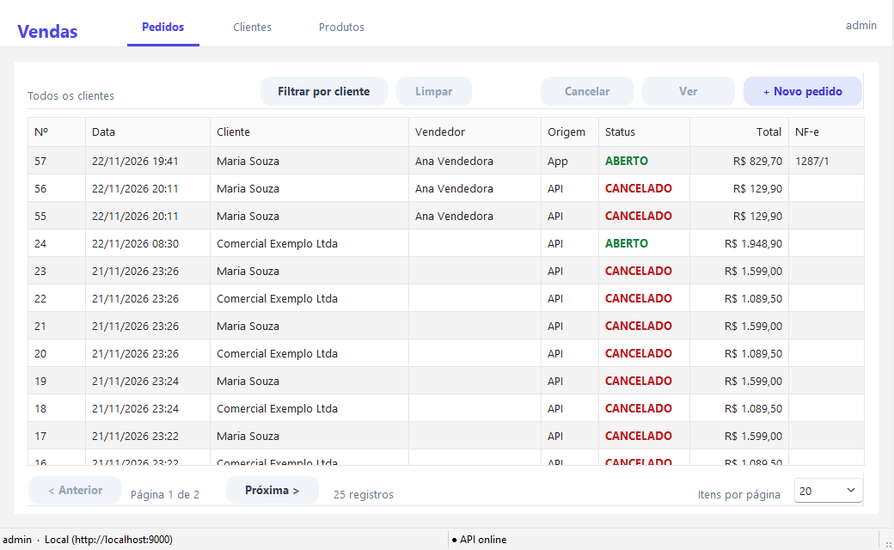
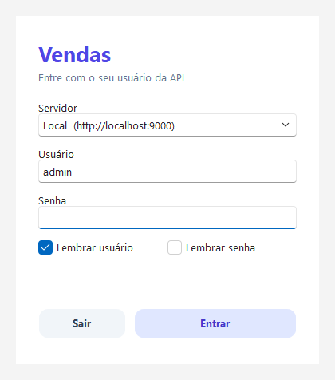
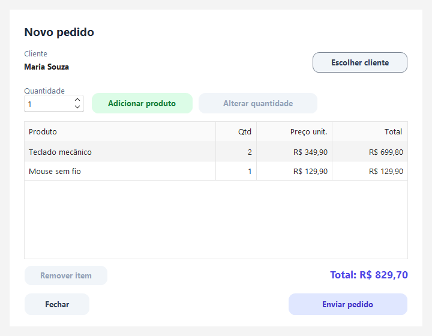
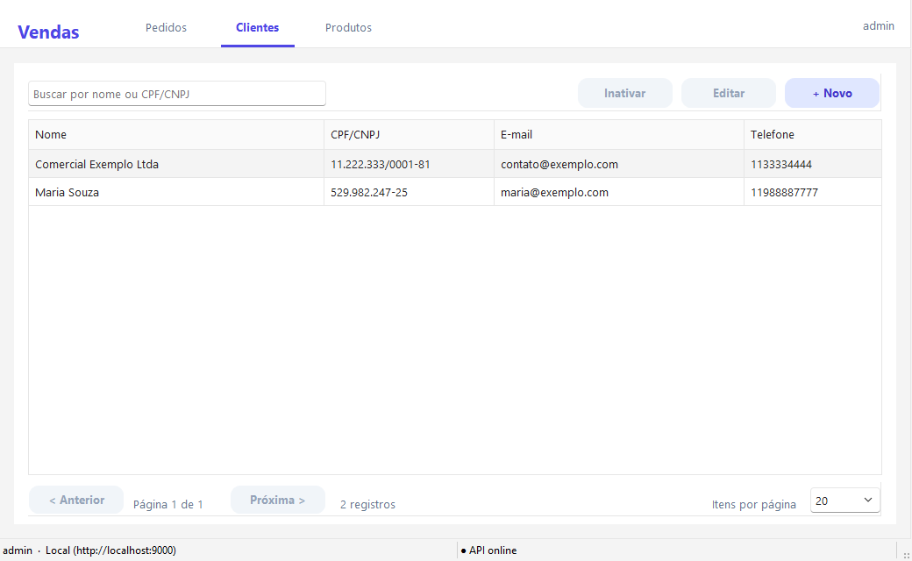
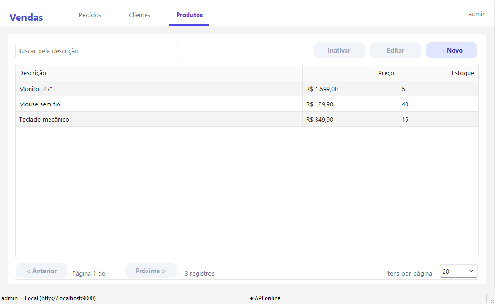
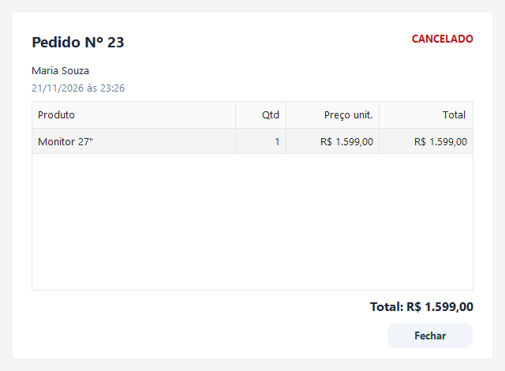
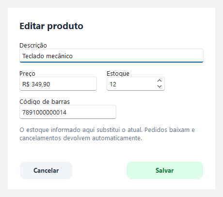

# delphi-vcl-client

Cliente desktop em **Delphi (VCL)** com **DevExpress** que consome a **[delphi-horse-api](https://github.com/kauelessa/delphi-horse-api)**: login com JWT, cadastro de clientes e produtos e emissão de pedidos com baixa de estoque.

> Faz parte do meu portfólio, junto com a API (back-end Horse + Firebird) e o [delphi-emissor-nfe](https://github.com/kauelessa/delphi-emissor-nfe): os pedidos criados aqui podem ser **faturados como NF-e** no emissor, que importa o pedido da API e completa os dados fiscais.



## 🎯 Objetivo

- Consumir **todos os endpoints** da API REST, com tratamento claro dos erros que ela devolve
- Arquitetura em camadas com um **cliente HTTP próprio e testável** (`IHttpClient`)
- Interface moderna com DevExpress, **sem travar a tela** durante as chamadas
- Rastreabilidade local: log da aplicação e log HTTP com os JSONs (senha e token mascarados)

## 🧱 Tecnologias

| Item | Versão / Ferramenta |
|---|---|
| Linguagem | Delphi (Object Pascal) — VCL |
| Componentes de interface | DevExpress VCL Controls v26.1.5 (skin WXI) |
| HTTP | `System.Net.HttpClient` (`THTTPClient`) |
| JSON | `System.JSON` |
| Credenciais | DPAPI do Windows |
| Testes | DUnitX |

## 🖥️ Funcionalidades

| Tela | O que faz | Endpoints |
|---|---|---|
| Login | Escolha do servidor (perfil), "lembrar usuário" e "lembrar senha" | `POST /auth/login` |
| Barra de status | Indicador de API online/offline, consultado a cada 30 s | `GET /health` |
| Clientes | Lista paginada com busca por nome ou CPF/CNPJ, cadastro, edição e inativação | `GET/POST/PUT/DELETE /clientes` |
| Produtos | Lista paginada com busca pela descrição, cadastro, edição (inclusive estoque) e inativação | `GET/POST/PUT/DELETE /produtos` |
| Pedidos | Lista paginada com filtro por cliente, detalhe com itens e cancelamento (devolve estoque) | `GET /pedidos`, `GET /pedidos/:id`, `PATCH /pedidos/:id/cancelar` |
| Novo pedido | Escolha do cliente e dos produtos, total ao vivo, rascunho automático e envio (baixa estoque) | `POST /pedidos` |

Quando o token expira (ele vale 60 minutos e a API não tem renovação), o sistema pede a senha de novo e repete a chamada que estava em andamento, sem perder o que estava na tela.

| | |
|---|---|
|  |  |
|  |  |
|  |  |

## 🏗️ Arquitetura

```
Views (forms e frames DevExpress)
   │  ExecutarAsync: chamada fora da thread da tela, retorno na thread principal
Controllers (ligação tela ↔ services, sem estado)
   │
Services (sessão e relogin, validação de obrigatórios, pedido em digitação, rascunho)
   │
Api.*  (rotas e JSON da API; status HTTP + {"erro"} → exceções)
   │
IHttpClient (única unit que fala HTTP; anexa o token e grava o log mascarado)
   │
delphi-horse-api  ──►  Firebird
```

- **Sem banco local:** os dados pertencem à API, que cria o próprio banco. O cliente guarda só arquivos (abaixo).
- **Regras de negócio na API:** CPF/CNPJ, estoque, preço e duplicidade são validados por ela; o cliente valida apenas campos obrigatórios e mostra a mensagem da API quando algo é recusado.
- **Testável sem a API no ar:** `Api.*` e os services são testados com um `IHttpClient` falso que devolve JSONs como os da API.
- **Telas fechadas no meio de uma chamada:** cada tela tem um "sinal de vida" (`ISinalVida`); se o usuário troca de aba antes da resposta chegar, o retorno é ignorado em vez de mexer num form já liberado.

## 💾 O que fica salvo na máquina

| Dado | Onde |
|---|---|
| Perfis de API, timeout, opções de log | `config.ini` ao lado do executável |
| Log da aplicação | `logs\AAAA-MM-DD.log` |
| Log HTTP (método, URL, status, tempo, JSON enviado e recebido) | `logs\http\AAAA-MM-DD.log` |
| Usuário e último servidor usados | `%APPDATA%\DelphiVclClient\usuario.ini` |
| Senha lembrada (opcional) | mesmo arquivo, **cifrada com DPAPI** |
| Posição da janela, itens por página, colunas dos grids | `%APPDATA%\DelphiVclClient\` |
| Rascunho do pedido em digitação | `%APPDATA%\DelphiVclClient\rascunho-pedido.json` |

Logs mais antigos que `RetencaoDias` (30 por padrão) são apagados na abertura.

## 🔒 Segurança

- A senha lembrada é cifrada pela **DPAPI** do Windows: só o mesmo usuário, na mesma máquina, consegue decifrá-la. Não há chave no código nem no arquivo.
- O log HTTP passa todo JSON por `MascararSegredos`: valores de `senha`, `token` e `password` viram `***`, em qualquer nível. O cabeçalho `Authorization` nunca é gravado.
- Nenhum endereço real, senha ou token é versionado: `config.ini` fica fora do Git e o `config.example.ini` usa valores de exemplo.

## ▶️ Como executar

1. Suba a [delphi-horse-api](https://github.com/kauelessa/delphi-horse-api) (por padrão em `http://localhost:9000`).
2. Copie `config.example.ini` para `config.ini`, ao lado do executável, e ajuste os endereços dos perfis de API. Sem o arquivo, o sistema usa um perfil "Local" em `http://localhost:9000`.
3. Abra `DelphiVclClient.dpr` no RAD Studio (com o DevExpress 26.1.5 instalado), compile e execute.
4. Entre com um usuário da API (em desenvolvimento, `admin` / `admin123`, criado pelo seed da API).

### Testes

Abra `tests/DelphiVclClientTests.dpr` (DUnitX, que vem com o RAD Studio) e execute. Os testes não precisam da API no ar nem do DevExpress. Cobrem conversão de JSON (inclusive com vírgula decimal no Windows em pt-BR), mapeamento de status HTTP em exceções, relogin com 401, mascaramento do log, DPAPI, montagem do pedido, rascunho e execução assíncrona.

## 🗺️ Roadmap

- [x] Login, sessão e credenciais lembradas (DPAPI)
- [x] Clientes e produtos (lista com busca, cadastro, edição e inativação)
- [x] Pedidos (lista, detalhe, novo pedido com rascunho e cancelamento)
- [x] Execução das chamadas fora da thread da tela
- [x] Janela principal com o visual em cartões e indicador de API online
- [x] Relogin automático quando o token expira
- [x] Prints e documentação

## 👤 Autor

**Kauê Lessa** — Desenvolvedor Delphi Sênior
[GitHub](https://github.com/kauelessa)
